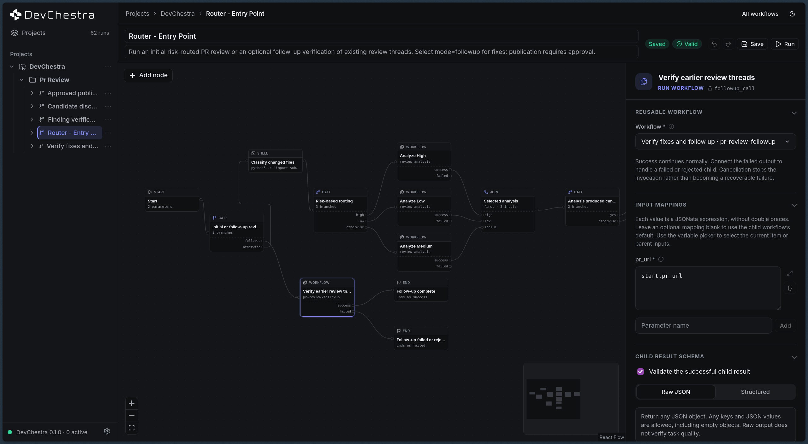
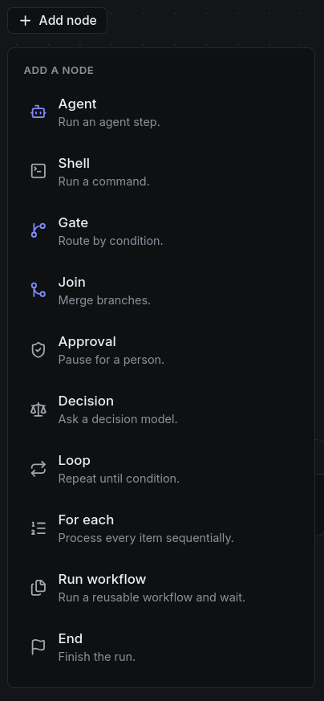

<h1>
  <picture>
    <source media="(prefers-color-scheme: dark)" srcset="assets/images/logo-lockup-light.svg">
    
  </picture>
</h1>

Conduct your coding agents like an orchestra.

DevChestra is a local workflow builder for headless coding agents. You drag a few boxes on a canvas, hit Run, and watch Claude, Codex, OpenCode, or Pi do the work in order — with branches, loops, and human check-ins where you want them.

It's not another agent to babysit. It's the stage your agents play on.



Above: a real DevChestra workflow that routes a PR review by risk, with a separate follow-up path. Runs, transcripts, and replay live in the same window.

## Why it's nice

Pasting the same instructions into chat every time and hoping the agent does it the same way? That's the problem. Chat is vibes: same prompt, different tools, different order, different day.

DevChestra makes the boring parts deterministic. You draw the process once — who runs, what tools and MCPs they get, what they're allowed to touch, what they must hand back, what happens next — and it runs that way every time. The agents still improvise inside their box (they're LLMs, after all), but the orchestration around them doesn't.

Research, then rank. Draft, then review. Write code, run tests, fix what broke. No babysitting prompts, no pasting output from one chat into the next.

## What you build with

Everything starts from the Add node menu. Ten nodes, that's the whole vocabulary:



Agent — run an agent step. Pick your CLI and model, write the prompt, done.

Shell — run a command. Tests, linters, scripts, whatever you'd run yourself.

Gate — route by condition. First matching branch wins, otherwise falls through.

Join — merge branches back together. Wait for the first one, or all of them.

Approval — pause for a person. Nothing moves until someone says go.

Decision — ask a decision model when you need a judgment call, not just code.

Loop — repeat until a condition is met. Each round keeps its own history.

For each — process every item in a list, one at a time.

Run workflow — call a reusable workflow and wait for it to finish.

End — finish the run.

## How a run feels

1. Register your project once by pointing DevChestra at a folder.
2. Draw your workflow. No JSON, the editor saves and validates as you go.
3. Press Run. Pick where it runs — your project folder as-is, an existing worktree, or a fresh worktree per run — then follow along live with events and transcripts.

If two people edit the same workflow, DevChestra catches the conflict instead of silently overwriting.

Agents automatically receive what came before them, so a plain prompt like "sort by total stars, descending" just works. No template syntax required unless you want it.

## Get going

You need Node 22 or newer and pnpm 10.14.0.

```sh
pnpm setup:global
devchestra start
```

That installs everything, links the `devchestra` command, and opens the editor in your browser. Run it again any time something looks off, it's safe to repeat.

Prefer the manual route?

```sh
pnpm install
pnpm build
pnpm devchestra start
```

To run a workflow straight from the terminal:

```sh
pnpm devchestra run examples/linear-codex.json \
  --project . \
  --param topic=devchestra \
  --json
```

Works with the CLIs you already signed in to: Claude Code, Codex, OpenCode, and Pi. DevChestra never asks for their keys, it just uses what's there.

Decision nodes are the one exception — they need their own keys. Copy `.env.example` to `.env` and fill in only the provider you use.

## It lives where you already work

Registering a project drops a `.devchestra/skill.md` file into your repo. It's a plain-English guide that teaches *your* agent — whatever lives in your REPL or IDE — how to write valid workflows for your project.

So you don't learn a new tool. You just tell your agent "add a workflow that lints, then asks me before fixing," and it draws the boxes for you. Rerun it, share it, version it like code.

Local-first, single user, your files stay yours. No cloud account, no queue, no sandbox magic — steps run with your normal permissions in the workspace you chose.

## Third-party icons

The monochrome provider icons are vendored from [LobeHub Icons](https://github.com/lobehub/lobe-icons) (MIT, Copyright (c) 2023 LobeHub) and the official Pi mark from pi.dev. The marks belong to their respective owners and are used only to identify the matching CLI.
